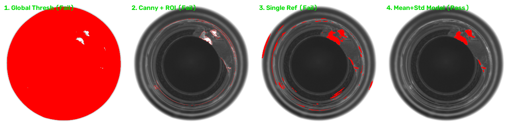

<div align="center">

# 🔍 Industrial Automated Visual Quality Control System

**Real-Time Surface Defect Detection & Industrial HMI Platform Combining Classical Statistical Computer Vision (CIE LAB) and Hybrid Deep Learning (Patch Memory Bank)**

[](https://github.com/Goruntu-Isleme-Otomatik-Kalite-Kontrol/automated-qc-inspection/actions/workflows/tests.yml)

**`Domain:`** Industrial Computer Vision &nbsp;|&nbsp; **`Dataset:`** MVTec Anomaly Detection &nbsp;|&nbsp; **`Architecture:`** CIE LAB + ResNet-18 &nbsp;|&nbsp; **`Interface:`** Streamlit HMI

</div>

---

## 📌 Overview

An end-to-end visual quality control platform engineered for manufacturing lines where only **defect-free (*good*)** reference samples are available during calibration and defect morphologies are unknown in advance (*unsupervised anomaly detection*).

The system unifies two distinct computer vision paradigms under a single preprocessing, evaluation, and diagnostic pipeline:

| Paradigm | Core Methodology | Primary Advantage | Optimal Use Case |
| :--- | :--- | :--- | :--- |
| **Classical Statistical CV (`_cv`)** | Pixel-wise statistical modeling ($\mu \pm k\sigma$) in the CIE LAB color space with morphological filtering | Lightweight and interpretable — no neural network or GPU required | Uniform textures under controlled industrial lighting |
| **Hybrid Deep Learning (`_nn`)** | OpenCV geometric normalization + multi-scale ResNet-18 L2-normalized Patch Memory Bank | High generalization across specular metallic reflections and complex textures | High-variance surfaces and subtle structural anomalies |

---

## 🚀 Release Milestones & Scope (`v1.0.0` → `v2.0.0`)

The platform was developed iteratively across three distinct architectural milestones:

| Version | Release Stage | Scope & Key Deliverables |
| :--- | :--- | :--- |
| **`v1.0.0`** | **Grayscale Statistical Baseline** | • Single-channel pixel mean and standard deviation ($\mu \pm k\sigma$) reference modeling.<br>• Otsu automatic background segmentation and morphological noise suppression (`cv2.MORPH_OPEN` / `MORPH_ELLIPSE`).<br>• Core `pytest` unit test suite and CLI evaluation baseline. |
| **`v1.1.0`** | **Multi-Channel CIE LAB Color Modeling** | • Migration from single-channel grayscale to 3-channel **CIE LAB** color space to decouple luminance (L<sup>&#42;</sup>) fluctuations from chromatic (a<sup>&#42;</sup>, b<sup>&#42;</sup>) surface defects.<br>• Modular YAML configuration architecture (`configs/*.yaml`) per product category.<br>• Full-dataset evaluation pipeline generating F1-score, IoU, and throughput metrics. |
| **`v2.0.0`** | **Hybrid ResNet-18 & Industrial HMI** | • Integration of pre-trained **ResNet-18** (`layer2` + `layer3`) spatial patch feature extraction with an L2-normalized **Patch Memory Bank**, boosting `metal_nut` F1-score by **+29.28 percentage points** (64.43% → 93.71%).<br>• Inverse affine coordinate alignment (`-dx, -dy`) mapping centered predictions back to raw image pixel coordinates.<br>• Multi-criteria Out-of-Distribution (**OOD / `INVALID`**) guard rejecting non-target objects.<br>• Dark-themed **Streamlit HMI** with side-by-side method comparison, live Ground Truth IoU/Dice verification, and `.png`/`.json` traceability export. |

> The configurations of the earlier milestones are kept in the repository for reproducibility: `configs/default.yaml` is the **v1.0** grayscale baseline and `configs/color_lab.yaml` the **v1.1** CIE LAB baseline (both on `bottle`). Each can be re-evaluated with `python -m src.evaluate --config <file>`.

---

## 🏗️ System Architecture

```text
                      ┌──────────────────────────────────┐
                      │      Raw Input Image (BGR)       │
                      └────────────────┬─────────────────┘
                                       │
                                       ▼
┌──────────────────────────────────────────────────────────────────────────────┐
│ 1. Preprocessing & Geometric Normalization (src/preprocessing.py)            │
│    • Gaussian Blur sensor noise suppression                                  │
│    • Otsu thresholding & corner pixel analysis for foreground segmentation   │
│    • Image moments (cv2.moments) centroid alignment shift (dx, dy)           │
└──────────────────────────────────────┬───────────────────────────────────────┘
                                       │
                  ┌────────────────────┴────────────────────┐
                  ▼                                         ▼
┌───────────────────────────────────┐     ┌────────────────────────────────────┐
│ Classical Statistical Track (_cv) │     │ Hybrid Deep Learning Track (_nn)   │
│ • CIE LAB Reference Model (μ, σ)  │     │ • ResNet-18 Mid-Layer Features     │
│ • Pixel Difference Map |I - μ|    │     │ • L2-Normalized Patch Memory Bank  │
│ • Adaptive Thresholding (> k·σ)   │     │ • Nearest-Neighbor Euclidean Dist. │
└─────────────────┬─────────────────┘     └─────────────────┬──────────────────┘
                  └────────────────────┬────────────────────┘
                                       │
                                       ▼
┌──────────────────────────────────────────────────────────────────────────────┐
│ 2. Post-Processing, Inverse Alignment & OOD Guard (app.py / inspection.py)   │
│    • Morphological opening/closing & minimum contour area filtering          │
│    • Inverse affine transform (-dx, -dy) for pixel-exact box/heatmap overlay │
│    • Multi-criteria Out-of-Distribution (INVALID) rejection gate             │
└──────────────────────────────────────┬───────────────────────────────────────┘
                                       │
                                       ▼
                 ┌────────────────────────────────────────────┐
                 │  Final Decision:  PASS  |  FAIL  | INVALID │
                 │  Anomaly Heatmap • Bounding Boxes • JSON   │
                 └────────────────────────────────────────────┘
```

<details>
<summary><b>📐 Mathematical Formulation & Decision Logic (Click to expand)</b></summary>
<br>

* **Centroid Alignment & Inverse Coordinate Mapping:**
  During preprocessing, the foreground binary mask $M(x,y)$ is used to compute the object centroid $(c_x, c_y)$ and shift the object to the frame center ($\Delta x = \frac{W}{2} - c_x, \; \Delta y = \frac{H}{2} - c_y$). Post-inference, predicted bounding boxes and anomaly heatmaps are shifted back via an inverse affine transformation to align pixel-for-pixel with the raw input frame:
  $$(x_{\text{orig}}, y_{\text{orig}}) = (x_{\text{pred}} - \Delta x, \; y_{\text{pred}} - \Delta y)$$

* **Patch-Level Anomaly Scoring:**
  Each extracted spatial feature vector $`f_i`$ is L2-normalized onto the unit hypersphere ($`\hat{\mathbf{f}}_i = \mathbf{f}_i / \|\mathbf{f}_i\|_2`$) and scored by its minimum Euclidean distance to the defect-free reference memory bank $`\mathcal{M}`$:

  $$s_i = \min_{\mathbf{m} \in \mathcal{M}} \|\hat{\mathbf{f}}_i - \mathbf{m}\|_2$$

* **Out-of-Distribution (`INVALID`) Protection:**
  To prevent unrelated or out-of-category images from triggering false `PASS` or `FAIL` decisions, four threshold-independent guardrails are enforced: peak anomaly score ($\max(S) > 0.98$), 90th-percentile heatmap distribution ($P_{90}(S) > 0.78$), Otsu foreground occupancy ($\notin [0.10, 0.80]$), and geometric aspect ratio deviation ($> 0.25$).

</details>

---

## 📊 6-Way Benchmark Results & Performance Analysis

Evaluations were conducted across three industrial categories from the **MVTec Anomaly Detection** dataset (`bottle`, `metal_nut`, `hazelnut`), calibrated strictly on defect-free training samples.

| Configuration | Paradigm | Accuracy | Precision | Recall | F1-Score | Mean IoU | Latency (ms/img) | FPS |
| :--- | :--- | :---: | :---: | :---: | :---: | :---: | :---: | :---: |
| `bottle_cv` | Classical CIE LAB | 90.36% | 92.31% | 95.24% | 93.75% | 25.24% | 30.00 | 33.3 |
| **`bottle_nn`** | **Hybrid ResNet-18** | **97.59%** | **96.92%** | **100.00%** | **98.44%** | **48.40%** | **17.98** | **55.6** |
| `metal_nut_cv` | Classical CIE LAB | 53.91% | 85.71% | 51.61% | 64.43% | 2.84% | 17.00 | 58.8 |
| **`metal_nut_nn`** | **Hybrid ResNet-18** | **90.43%** | **100.00%** | **88.17%** | **93.71%** | **30.83%** | **16.50** | **60.6** |
| `hazelnut_cv` | Classical CIE LAB | 71.82% | 77.46% | 78.57% | 78.01% | 12.41% | 35.95 | 27.8 |
| **`hazelnut_nn`** | **Hybrid ResNet-18** | **91.82%** | **88.61%** | **100.00%** | **93.96%** | **26.49%** | **28.64** | **34.9** |

> All values are taken directly from [`results/benchmark_summary.csv`](results/benchmark_summary.csv). Detection metrics (accuracy, precision, recall, F1, IoU) are deterministic and reproduce exactly on other machines. Latency and FPS were measured on the development machine and depend on the hardware: on a CPU-only laptop (Python 3.12, Windows) the hybrid track runs at ~124–191 ms per image (5–8 FPS).

### Key Engineering Takeaways
* **Substantial Gain on Specular Metallic Surfaces:** While classical pixel differencing performs reliably on uniform backgrounds (`bottle`), metallic reflections and rotational variance in `metal_nut` degrade classical performance to `64.43%` F1. The hybrid patch memory bank achieves **`93.71%` F1** (**+29.28 percentage points**) and raises localization IoU from `2.84%` to `30.83%`.
* **Consistent Improvement Across All Categories:** Averaged over the three categories, the hybrid track reaches **95.37%** F1 versus **78.73%** for the classical track (**+16.64 percentage points**), with 100% recall on `bottle` and `hazelnut`.
* **Throughput Depends on Hardware:** On the development machine the hybrid pipeline runs at **~17–29 ms per frame (35–61 FPS)**, fast enough for inline inspection. On CPU-only hardware throughput drops to 5–8 FPS, so a GPU is recommended for real-time conveyor deployment.
* **Localization Remains the Main Open Challenge:** Image-level decisions are reliable, but pixel-level mean IoU stays between `26%` and `48%` for the hybrid track; defects are found in the right region but their exact boundaries are only partially recovered.

---

## 🧪 Ablation Study: Why a Statistical Reference Model?

Before settling on the per-pixel statistical model of the classical track, four classical approaches were compared on the same aligned `bottle` images (`experiments/ablation_study.py`). Pixels flagged as defective are highlighted in red:

| # | Method | Result | Reason |
| :---: | :--- | :---: | :--- |
| 1 | Global thresholding | ❌ | The dark bottle body itself falls below the threshold, so almost the entire object is flagged. |
| 2 | Canny edges inside a circular ROI | ❌ | Concentric neck rings and specular reflections produce edges on intact bottles. |
| 3 | Difference to a single reference image | ❌ | Small rotational differences between bottles create crescent-shaped false alarms along the rim. |
| 4 | Per-pixel mean + std reference model | ✅ | An adaptive tolerance (`2.8·σ + 25`) absorbs natural variation and flags only the true defect. |

**Defective sample (`fail_01.png`):**



**Defect-free sample (`pass_02.png`):**


### Quantitative Results on the Full `bottle` Test Set

To verify that the visual impression holds beyond two samples, all four methods were run on the complete `bottle` test set (63 defective, 20 defect-free images) with the same decision rule: an image is classified as `FAIL` when at least 150 pixels are flagged.

| Method | Accuracy | Precision | Recall | Specificity | F1-Score | False-Alarm Area |
| :--- | :---: | :---: | :---: | :---: | :---: | :---: |
| 1. Global threshold | 75.90% | 75.90% | 100.00% | 0.00% | 86.30% | 62.49% |
| 2. Canny + ROI | 75.90% | 75.90% | 100.00% | 0.00% | 86.30% | 0.30% |
| 3. Single reference | 77.11% | 76.83% | 100.00% | 5.00% | 86.90% | 2.11% |
| **4. Mean + std model** | **89.16%** | **89.71%** | **96.83%** | **65.00%** | **93.13%** | **0.03%** |

*Specificity: share of defect-free bottles correctly classified as `PASS`. False-alarm area: average share of a defect-free bottle's pixels that are wrongly flagged.*

* **F1 alone is misleading on this test set.** Methods 1–3 classify (almost) every bottle as defective, which yields 100% recall and an F1-score of ~86% purely because defective images outnumber defect-free ones 63 to 20. Their specificity of 0–5% shows that they cannot recognize an intact bottle at all.
* **Only the statistical model separates the two classes**, with 65% specificity and a false-alarm area of just 0.03% of the image.
* **Remaining limitation:** even the statistical model still raises an alarm on 7 of 20 intact bottles, which motivated the hybrid ResNet-18 track (2 of 20 on the same test set).
* The F1-score of method 4 (93.13%) differs slightly from the v1.0 baseline evaluated with `src.evaluate` (93.85%) because the production pipeline applies the area threshold per connected defect region instead of to the total number of flagged pixels.

Reproduce the figures and the table (written to `results/ablation_summary.csv`) with:
```bash
python -m experiments.ablation_study
```

---

## 🔬 Empirical Failure Analysis & Trade-offs

* **Sensitivity vs. False-Alarm Trade-off (`metal_nut / color / 004.png`):**
  A micro-scale paint blemish along the inner bore of the metal nut registered an anomaly peak of `0.767` (exceeding the `0.76` threshold) and localized accurately on the heatmap. However, because its connected pixel area fell below `min_defect_area_px` (`120 px`) and was suppressed by morphological opening, the final classification returned `PASS`. Maintaining a conservative threshold (`0.76`) and minimum area filter prevents specular metallic glare on intact nuts from triggering false positives, stabilizing overall accuracy at **90.43%** while leaving sub-threshold micro-stains at the sensitivity boundary.
* **Pixel-Exact Coordinate Alignment (`hazelnut / cut / 014.png`):**
  Centroid shifting during preprocessing initially introduced a `15–25 px` spatial offset between detected bounding boxes and raw defect locations. Incorporating `compute_centering_shift` and inverse `cv2.warpAffine` mapping eliminated this discrepancy across both tracks.
* **False Alarms on Intact Hazelnuts (`hazelnut_nn`):**
  The hybrid track catches every defective hazelnut (recall `100%`) but flags 9 of 40 defect-free test samples as `FAIL` (precision `88.61%`). The natural shape and texture variation of hazelnuts is wider than the training set covers; in a production setting this would mean intact products being rejected, so the threshold for this category trades false alarms for zero missed defects.
* **Remaining Misses on `metal_nut`:**
  The hybrid track detects all `bent`, `flip` and `good` samples correctly; its remaining errors concentrate in `scratch` (17/23) and `color` (17/22), where defects are small and visually close to normal metallic glare.

---

## 🖥️ Industrial HMI Interface

The Streamlit diagnostic workstation (`app.py`) provides an operator-ready inspection environment:

* **Live Inspection & Visual Diagnostics:** Inspect MVTec test samples by defect category or upload external images for instant anomaly scoring and heatmap generation.
* **Side-by-Side Paradigm Comparison:** Toggle simultaneous evaluation to compare Classical CV and Hybrid AI outputs on the same sample in a single view.
* **Ground Truth Overlay & Live IoU / Dice:** Automatically loads MVTec pixel masks, renders green defect contours, and computes real-time sample-level IoU and Dice scores.
* **Dynamic Threshold & Heatmap Alpha Controls:** Adjust decision sensitivity and heatmap overlay opacity (`0.0` – `1.0`) in real time.
* **Inspection Traceability Export:** Download annotated inspection images (`.png`) alongside timestamped audit logs (`.json`) containing bounding box coordinates, anomaly scores, and latency metrics.

---

## ⚡ Installation & Usage

> **Requirements:** Python 3.11 or 3.12 (tested with Python 3.12 on Windows, CPU only). Newer interpreters such as Python 3.14 have not been verified yet.

### 1. Clone the Repository & Create a Virtual Environment
```bash
git clone https://github.com/Goruntu-Isleme-Otomatik-Kalite-Kontrol/automated-qc-inspection.git
cd automated-qc-inspection
python -m venv .venv
```

Activate the environment:
```bash
# Windows (PowerShell)
.venv\Scripts\activate

# macOS / Linux
source .venv/bin/activate
```

Install the dependencies:
```bash
pip install -r requirements.txt
```

> `opencv-python-headless` is used intentionally so the project also runs in headless environments (GitHub Codespaces, CI runners, Docker) that do not provide `libGL`.

### 2. Download the MVTec AD Dataset
The dataset is **not included** in this repository because of its size and license. Download the following three categories from the [official MVTec AD download page](https://www.mvtec.com/company/research/datasets/mvtec-ad/downloads):

| Category | Archive | Size |
| :--- | :--- | :---: |
| Bottle | `bottle.tar.xz` | ~149 MB |
| Hazelnut | `hazelnut.tar.xz` | ~589 MB |
| Metal Nut | `metal_nut.tar.xz` | ~158 MB |

Place the three archives in `data/raw/` and extract them (this Python command works on every operating system):
```bash
mkdir -p data/raw
cd data/raw
python -c "import tarfile; [tarfile.open(f'{c}.tar.xz').extractall(filter='data') for c in ('bottle', 'hazelnut', 'metal_nut')]"
cd ../..
```

The resulting layout must look like this:
```text
data/raw/
├── bottle/
│   ├── train/good/
│   ├── test/
│   └── ground_truth/
├── hazelnut/
└── metal_nut/
```

> `data/raw/` is excluded from version control via `.gitignore`. MVTec AD is distributed under the CC BY-NC-SA 4.0 license (non-commercial use only).

### 3. Run Automated Verification Tests
```bash
python -m pytest -v
```

### 4. Generate Reference Caches & 6-Way Benchmark Report
```bash
# All six configurations (writes results/benchmark_summary.csv)
python -m src.evaluate --all

# A single configuration
python -m src.evaluate --config configs/bottle_cv.yaml
```

> The first run downloads the ImageNet-pretrained ResNet-18 weights (~45 MB). On a CPU-only machine the full benchmark takes several minutes. Latency and FPS values depend on the hardware; running `--all` overwrites the committed summary CSV.

### 5. Launch the Industrial HMI Dashboard
```bash
streamlit run app.py
```

> On the very first launch Streamlit may ask for an e-mail address in the terminal; press **Enter** to skip.

### 6. Command-Line Inspection (optional)
```bash
# Inspects the config's input_dir (data/golden_set by default) and prints PASS / FAIL per image
python main.py
python main.py --config configs/bottle_nn.yaml
```

---

## 📂 Repository Structure

```text
├── .github/
│   └── workflows/tests.yml     # CI: runs the pytest suite on every push and pull request
├── .streamlit/
│   └── config.toml             # Industrial dark theme configuration
├── configs/
│   ├── default.yaml            # v1.0 grayscale baseline (bottle); default when no --config is given
│   ├── color_lab.yaml          # v1.1 CIE LAB baseline (bottle)
│   ├── bottle_cv.yaml          # Bottle — Classical CIE LAB configuration
│   ├── bottle_nn.yaml          # Bottle — Hybrid ResNet-18 configuration
│   ├── metal_nut_cv.yaml       # Metal Nut — Classical CIE LAB configuration
│   ├── metal_nut_nn.yaml       # Metal Nut — Hybrid ResNet-18 configuration
│   ├── hazelnut_cv.yaml        # Hazelnut — Classical CIE LAB configuration
│   └── hazelnut_nn.yaml        # Hazelnut — Hybrid ResNet-18 configuration
├── data/
│   ├── golden_set/             # 8 reference images (4 PASS / 4 FAIL) used by the test suite
│   ├── raw/                    # MVTec AD categories (downloaded manually, not versioned)
│   └── cache/                  # Memory banks & reference caches generated at runtime
├── docs/
│   └── images/                 # Figures used in the documentation (ablation study)
├── experiments/
│   └── ablation_study.py       # Ablation study comparing four classical methods
├── outputs/                    # Reference caches of the v1.0 / v1.1 baselines (.npz)
├── results/
│   ├── ablation_summary.csv    # Quantitative ablation results written by `experiments.ablation_study`
│   └── benchmark_summary.csv   # 6-way benchmark summary written by `src.evaluate --all`
├── src/
│   ├── __init__.py             # Package initialization
│   ├── acquisition.py          # Image loading & dataset input ingestion
│   ├── preprocessing.py        # Foreground segmentation & centroid alignment
│   ├── inspection.py           # Classical statistical defect detection (CIE LAB)
│   ├── nn_detector.py          # ResNet-18 patch memory bank inference engine
│   ├── postprocessing.py       # Morphological filtering, contour extraction & inverse alignment
│   ├── pipeline.py             # End-to-end inspection orchestrator & PASS/FAIL decision logic
│   └── evaluate.py             # Multi-configuration benchmark & metrics pipeline
├── tests/
│   ├── test_pipeline.py        # End-to-end golden-set safety & artifact test
│   ├── test_preprocessing.py   # Preprocessing shape, LAB & centroid alignment tests
│   └── test_nn_detector.py     # ResNet-18 patch extraction, memory bank & detection tests
├── app.py                      # Streamlit HMI diagnostic application
├── main.py                     # Command-line inspection (prints PASS / FAIL per image)
├── pytest.ini                  # pytest configuration
├── requirements.txt            # Project dependencies
├── .mailmap                    # Unifies commit author identities
└── README.md                   # Project documentation
```
