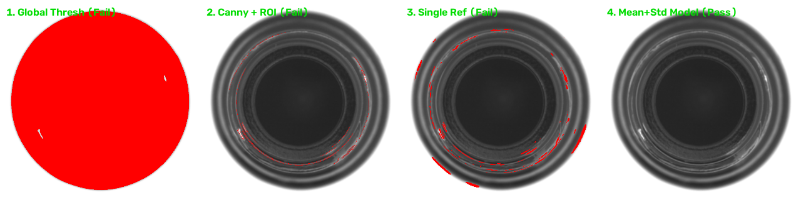

# Automated Visual Quality Control Inspection (MVTec AD — Bottle)

Modular classical computer vision pipeline for automated industrial defect detection on overhead glass bottle images from the **MVTec Anomaly Detection (MVTec AD)** dataset. Supports both single-channel **Grayscale** and 3-channel **CIE LAB** statistical reference modeling, built with Python, OpenCV, NumPy, and `pytest` using an iterative Agile workflow.

---

## 1. Pipeline Architecture

```text
data/golden_set/ ──► acquisition.py ──► preprocessing.py ──► inspection.py ──► postprocessing.py
                                              │                     ▲                  │
                                              ▼                     │                  ▼
                                    Centroid Alignment      Statistical Model    Annotated Images
                                    (cv2.moments + Warp)   (mean ± k*std .npz)   + outputs/report.csv
```

* **`configs/default.yaml` & `configs/color_lab.yaml`**: Centralize directory paths, preprocessing parameters (`gray` vs. `lab`), and adaptive statistical thresholds.
* **`src/acquisition.py`**: Loads input images deterministically from target directories.
* **`src/preprocessing.py`**: Segments the bottle silhouette via Gaussian smoothing and inverse binary thresholding, computes the centroid (`cv2.moments`), and applies affine translation (`cv2.warpAffine`) to align every bottle to the frame center in either 1-channel Grayscale or 3-channel `CIE LAB`.
* **`src/inspection.py`**: Compares each aligned sample against a pixel-wise statistical golden model ($\mu \pm (k\sigma + \text{offset})$) learned from 200 normal training samples, collapsing 3-channel color deviations across `L`, `a`, and `b` before morphological opening and contour area filtering.
* **`src/postprocessing.py`**: Draws defect bounding boxes and `PASS` / `FAIL` status overlays onto output images.
* **`src/pipeline.py`**: Orchestrates end-to-end batch inspection, caches statistical reference models (`outputs/reference_model.npz` and `outputs/reference_model_lab.npz`), and exports structured CSV audit logs.
* **`src/evaluate.py`**: Benchmarks classification performance (`Accuracy`, `Precision`, `Recall`, `F1-Score`, and Confusion Matrix) across all 83 MVTec test samples (`broken_large`, `broken_small`, `contamination`, `good`).
* **`experiments/ablation_study.py`**: Reproduces visual failure-mode comparisons across earlier baseline methods.

---

## 2. Quickstart

### Setup Environment
```powershell
python -m venv .venv
.venv\Scripts\Activate.ps1
pip install -r requirements.txt
```

### Run Automated Tests
```powershell
pytest
```

### Run Batch Inspection (Golden Set + CSV Report)
```powershell
# Default Grayscale Safety-First Model
python main.py --config configs/default.yaml

# 3-Channel CIE LAB Color Model
python main.py --config configs/color_lab.yaml
```

### Run Full MVTec Test-Set Benchmark (83 Images)
*(Requires full MVTec `bottle` dataset extracted under `data/raw/`)*
```powershell
python -m src.evaluate --config configs/default.yaml
python -m src.evaluate --config configs/color_lab.yaml
```

---

## 3. Iterative Engineering Evolution & Benchmark Results

1. **Global Thresholding (Sprint 1):** Failed by flagging the entire dark amber bottle body against the white background.
2. **Canny Edge Detection + Eroded ROI:** Failed due to false positives on normal concentric bottle neck rings and specular reflections.
3. **Single-Reference Subtraction:** Failed due to rotational variance of bottle screw threads.
4. **Centroid-Aligned Grayscale Statistical Model (`v1.0.0`):** Solved rotational variance by modeling pixel-wise mean ($\mu$) and standard deviation ($\sigma$) across 200 aligned normal training bottles.
5. **3-Channel CIE LAB Statistical Model (`v1.1.0`):** Extended pixel-wise modeling to 3D `(H, W, 3)` `CIE LAB` space, separating chromatic shifts (`a`, `b`) from luminance (`L`) to eliminate false alarms at high defect recall.

### Model & Hyperparameter Comparison (83 Test Samples)

| Configuration & Color Space | Parameters (`std` / `diff` / `area`) | `broken_large` | `broken_small` | `contamination` | `good` | Accuracy | Precision | Recall | F1-Score |
| :--- | :---: | :---: | :---: | :---: | :---: | :---: | :---: | :---: | :---: |
| **Grayscale — Conservative** | `3.5 / 25 / 250` | 20/20 (100%) | 21/22 (95.5%) | 16/21 (76.2%) | **20/20 (100%)** | 92.77% | **100.00%** | 90.48% | 95.00% |
| **Grayscale — Safety-First (`default.yaml`)** | `2.8 / 25 / 150` | **20/20 (100%)** | **22/22 (100%)** | **19/21 (90.5%)** | 14/20 (70.0%) | 90.36% | 91.04% | **96.83%** | 93.85% |
| **CIE LAB — High-Precision** | `3.2 / 25 / 180` | **20/20 (100%)** | 21/22 (95.5%) | 18/21 (85.7%) | 19/20 (95.0%)| **93.98%** | 98.33% | 93.65% | **95.93%** |
| **CIE LAB — Safety-First (`color_lab.yaml`)** | `3.1 / 22 / 160` | **20/20 (100%)** | **22/22 (100%)** | **19/21 (90.5%)** | 16/20 (80.0%) | 92.77% | 93.85% | **96.83%** | 95.31% |

### Confusion Matrix — Active CIE LAB Safety-First Model (`configs/color_lab.yaml`)

| Ground Truth \ Prediction | Predicted `FAIL` (Defective) | Predicted `PASS` (Good) | Total |
| :--- | :---: | :---: | :---: |
| **Actual Defective** (`broken_large`, `broken_small`, `contamination`) | **61** (True Positive) | **2** (False Negative)| 63|
| **Actual Good** (`good`) | **4** (False Positive) | **16** (True Negative) | 20 |
| **Total** | 65 | 18 | **83** |

### Visual Ablation Proof (Why Earlier Methods Failed)

| Method | Behavior on Defect-Free Bottle (`pass_02.png`) | Root Cause of Failure |
| :--- | :--- | :--- |
| **1. Global Thresholding** | Flags entire bottle silhouette as defect | High contrast between dark amber glass and white background |
| **2. Canny Edges + ROI** | Flags normal circular neck rings & reflections | Concentric manufacturing grooves create strong intensity gradients |
| **3. Single-Image Subtraction** | Flags crescent arcs around screw threads | Rotational variation between individual bottles on the conveyor |
| **4. Centroid + Mean/Std Model** | **0 false-positive pixels** | High $\sigma$ in thread rings expands local tolerance automatically |


